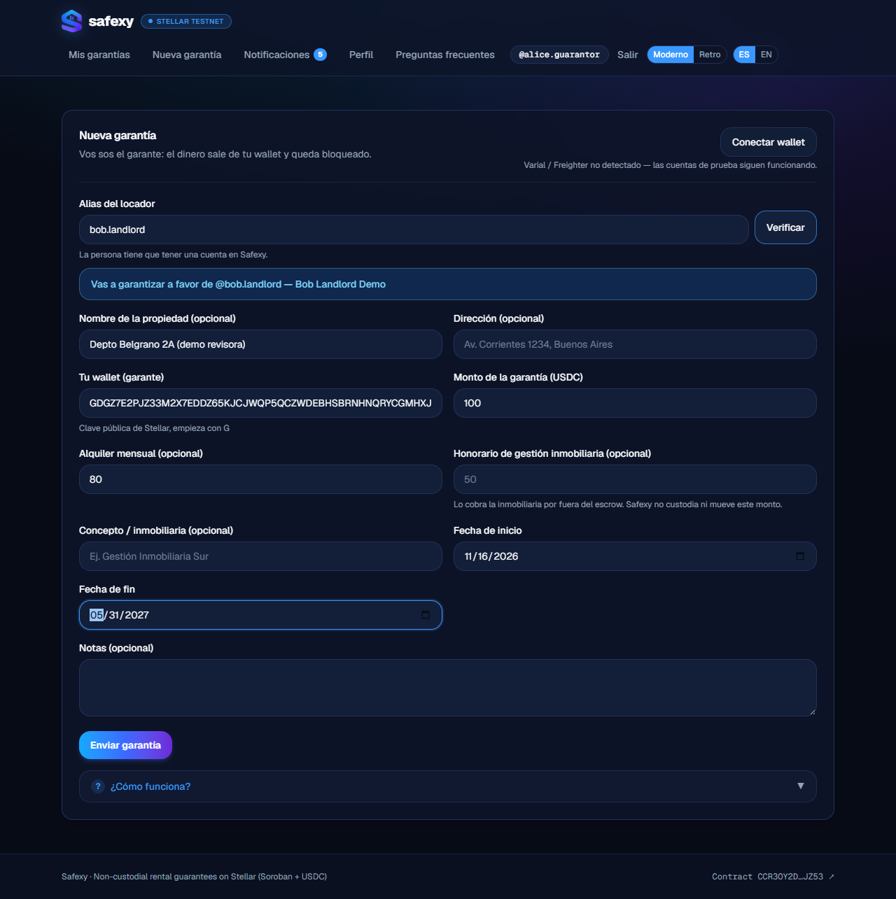
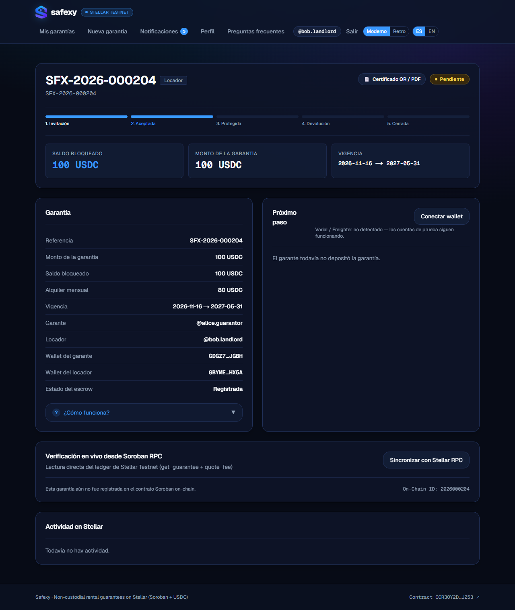
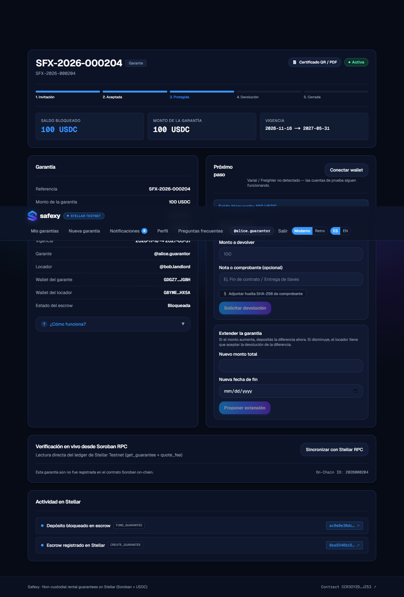
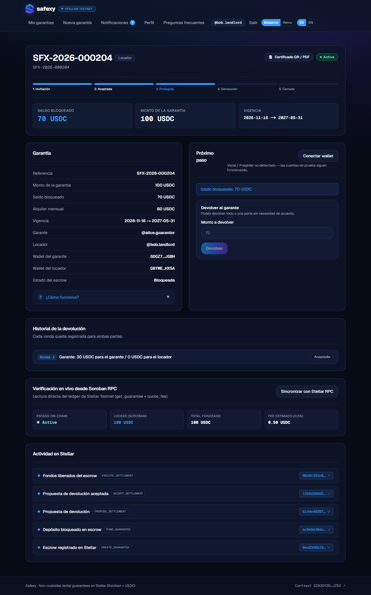
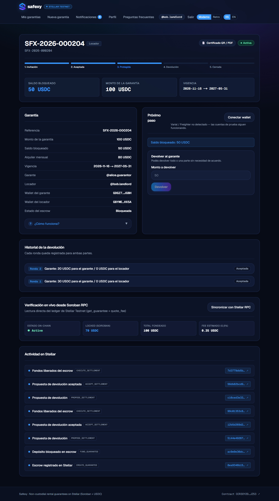
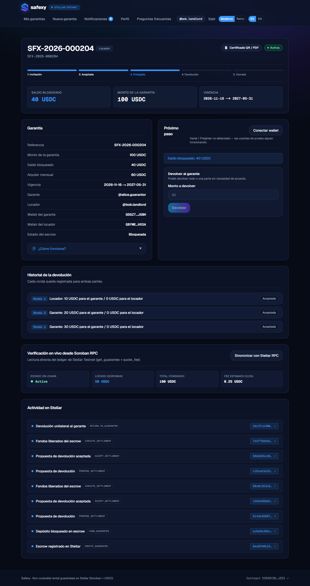
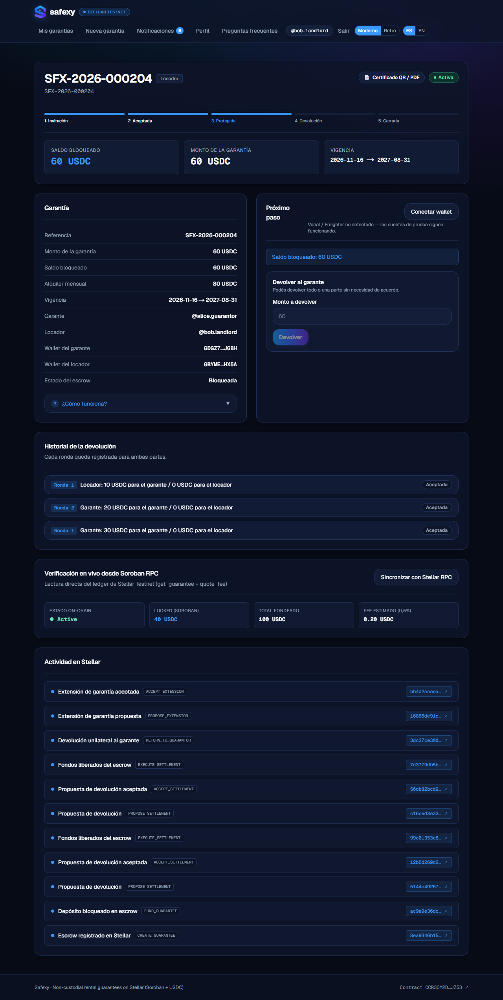
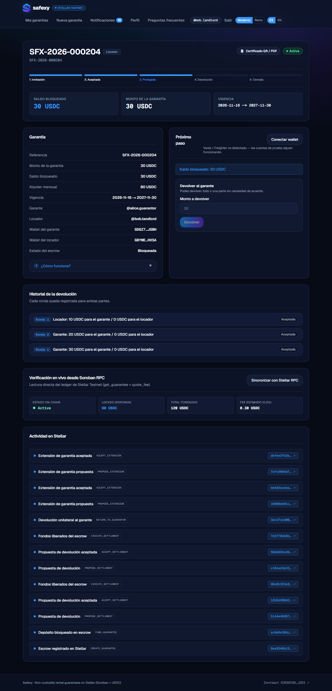

# Safexy — Guía para la revisora

Esta guía sirve para probar Safexy con tus propias manos, desde el navegador,
sin instalar nada y sin conocimientos técnicos. Lleva unos 10 minutos.

Todo ocurre en **Stellar Testnet**, la red de pruebas de Stellar: el dinero
(USDC de prueba) no tiene valor real, pero cada movimiento queda registrado de
verdad en la blockchain y se puede comprobar en un explorador público.

## Qué es Safexy, en una frase

Un garante deja una garantía de alquiler en dólares digitales (USDC) bloqueada
en la blockchain. Nadie puede llevársela solo: el dinero se libera únicamente
cuando garante y locador se ponen de acuerdo, o cuando el locador decide
devolverlo al garante.

## Antes de empezar

- Link de la app: **https://rental-guarantee-stellar.vercel.app**
- Hay dos usuarios de prueba, ya cargados con USDC de prueba:

| Papel | Quién es | Usuario | Contraseña |
| --- | --- | --- | --- |
| Garante (pone la plata) | Alice | `alice@example.com` | `demo1234` |
| Locador (dueño del depto) | Bob | `bob@example.com` | `demo1234` |

- No hace falta escribir usuario y contraseña: en la pantalla de ingreso hay
  dos botones, **"Entrar como Garante (@alice.guarantor)"** y **"Entrar como
  Locador (@bob.landlord)"**.
- Para pasar de un usuario al otro, tocá **"Salir"** arriba a la derecha y
  volvé a entrar con el otro botón. (También podés tener a Alice en una ventana
  normal y a Bob en una ventana de incógnito.)
- No necesitás una billetera propia: las firmas de estas cuentas de prueba las
  hace la app por vos.

## Paso a paso

### 1. Alice crea la garantía

1. Entrá con **"Entrar como Garante (@alice.guarantor)"**.
2. Tocá **"Nueva garantía"** en el menú.
3. En "Alias del locador" escribí `bob.landlord` y tocá **"Verificar"**. Aparece
   "Vas a garantizar a favor de @bob.landlord".
4. Monto de la garantía: `100`. Elegí una fecha de inicio y una de fin.
5. Tocá **"Enviar garantía"**.

### 2. Bob la acepta

1. Tocá **"Salir"** y entrá con **"Entrar como Locador (@bob.landlord)"**.
2. Abrí la garantía nueva y tocá **"Aceptar"**.

### 3. Alice deposita la plata

1. Volvé a entrar como Alice y abrí la garantía.
2. Tocá **"1. Registrar escrow"** (prepara la caja fuerte en la blockchain) y
   después **"2. Depositar y bloquear"**.
3. La garantía pasa a **Activa** y arriba dice **Saldo bloqueado: 100 USDC**.

### 4. Dos devoluciones parciales seguidas

1. Como Alice, en "Pedir devolución" escribí `30` y tocá **"Solicitar
   devolución"**.
2. Como Bob, tocá **"Aceptar"** y después **"Ejecutar y liberar"**. Quedan
   **70 USDC** bloqueados y la garantía sigue activa.
3. Repetí con `20`: quedan **50 USDC** bloqueados.

### 5. Bob devuelve plata por su cuenta

Como Bob, en "Devolver al garante" escribí `10` y tocá **"Devolver"**. No
necesita que Alice acepte nada, porque sólo puede favorecerla. Quedan
**40 USDC** bloqueados.

### 6. Extender la garantía subiendo el monto

1. Como Alice, en "Extender la garantía" poné nuevo monto `60` y una fecha de
   fin posterior. Tocá **"Proponer extensión"**. Alice deposita en ese momento
   los 20 USDC de diferencia.
2. Como Bob, tocá **"Aceptar extensión"**. Quedan **60 USDC** bloqueados.

### 7. Extender la garantía bajando el monto

1. Como Alice, proponé nuevo monto `30` y otra fecha de fin.
2. Como Bob, tocá **"Aceptar extensión"**. Los 30 USDC de diferencia vuelven a
   Alice (menos la comisión de 0,5 %) y quedan **30 USDC** bloqueados.

## Cómo comprobar que es real

Al final de cada garantía hay una sección **"Actividad en Stellar"**. Cada
renglón tiene un código (el "hash" de la operación); al tocarlo se abre
**stellar.expert**, un explorador público e independiente de Safexy, donde se
ve el movimiento real en la blockchain: quién lo hizo, cuándo y cuánto.

En el pie de cada página está el enlace al contrato de Safexy en stellar.expert.

## Comisión de Safexy

Safexy cobra **0,5 %** sólo sobre lo que se le devuelve al garante (por
ejemplo, 0,15 USDC sobre una devolución de 30 USDC). Nunca se descuenta nada de
lo que recibe el locador. La app muestra la comisión antes de confirmar.

## Video

Hay un video del recorrido completo grabado en la app pública:
[`screenshots/demo-ui-completo.webm`](screenshots/demo-ui-completo.webm)
(se abre con cualquier navegador). Todas las capturas están en
[`screenshots/ui-run/`](screenshots/ui-run/).

## Para profundizar

El reporte con todos los códigos de operación, enlaces y saldos verificados
está en [`VERIFICATION.md`](VERIFICATION.md).
