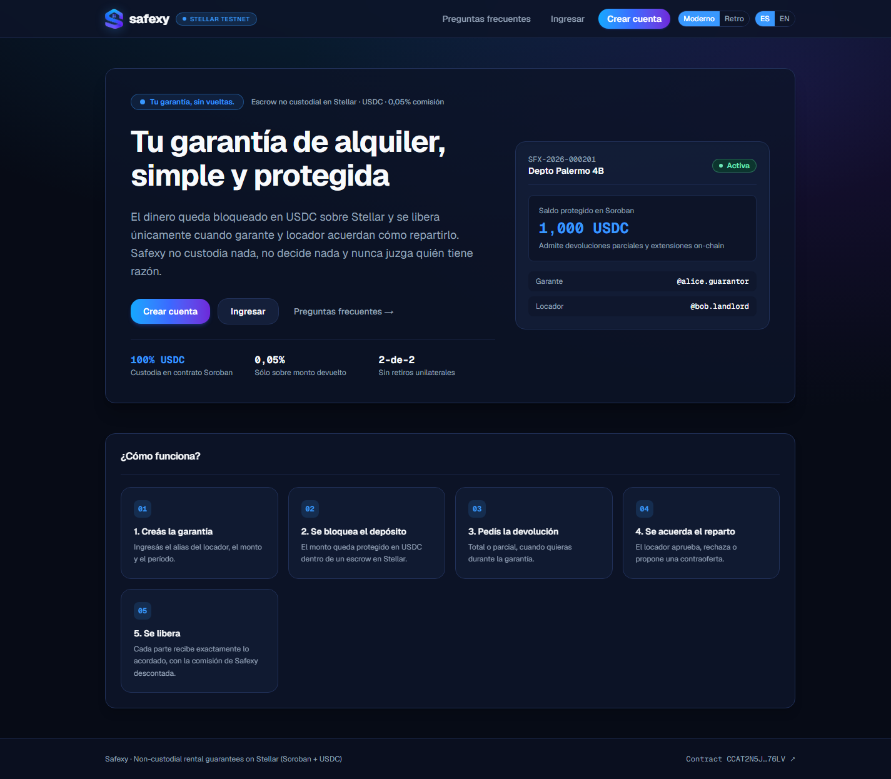
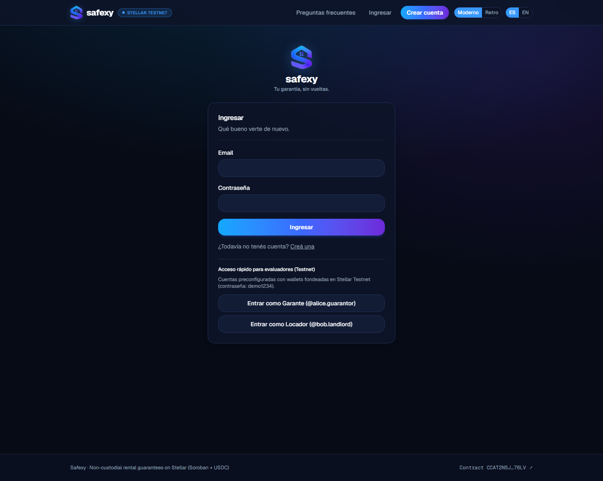
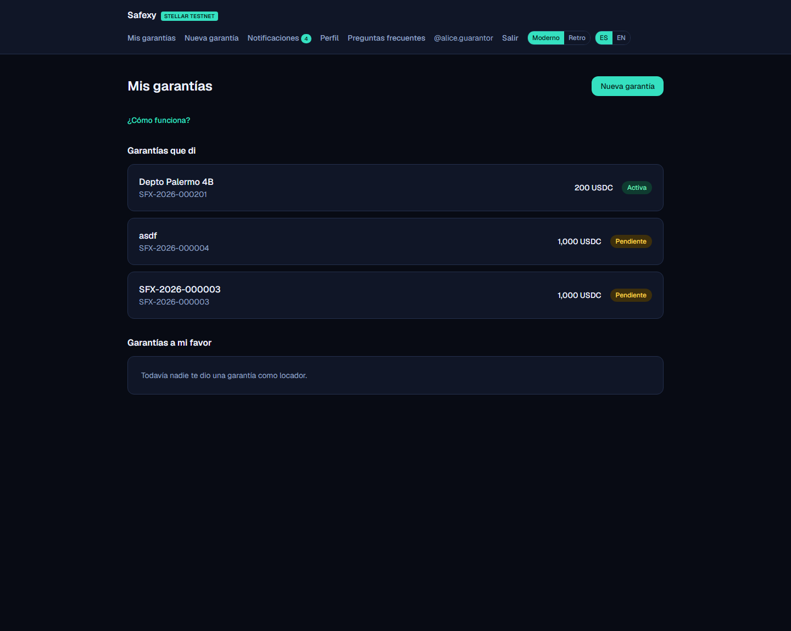
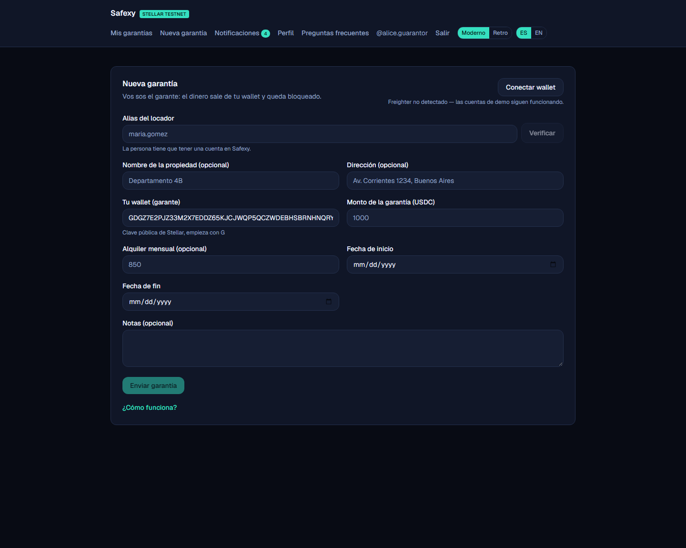
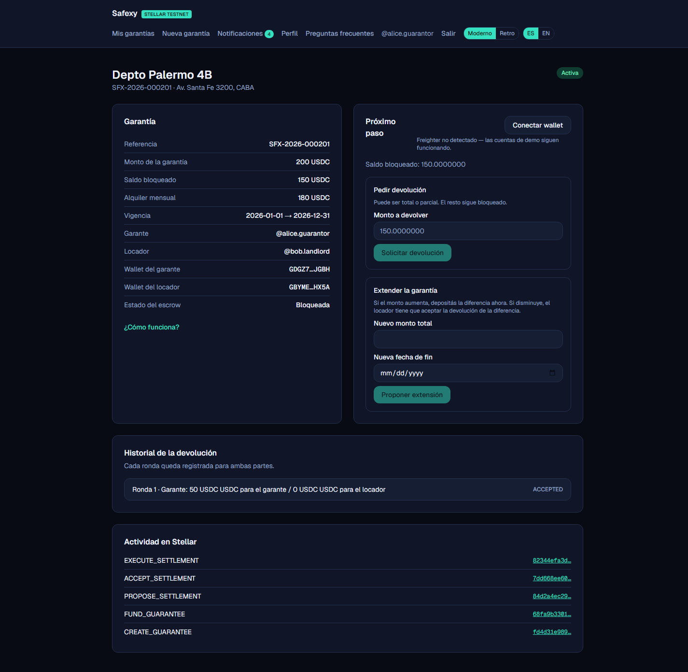

# SAFEXY — Consolidated On-Chain Verification Report & Reviewer Walkthrough

**Instaward 30-Day Scoped Engagement — Deliverables 1, 2 & 3 (Weeks 1–4)**

This document consolidates all on-chain evidence, clickable block-explorer links, state transitions, balance verifications, and the step-by-step reviewer walkthrough for **Safexy** on **Stellar Testnet**. Any reviewer or judge can verify every transaction and invariant independently with zero local setup.

> **Nota sobre la comisión:** las corridas on-chain documentadas abajo se ejecutaron con
> `fee_bps = 5` (0,05 %), que era la configuración vigente en ese momento. A partir del
> 2026-11-10 la comisión comercial es **0,5 % (`fee_bps = 50`)** en el código y en la UI;
> el contrato desplegado puede actualizarse con `set_fee_bps(50)` desde la cuenta admin
> sin redesplegar. La comisión nunca se cobra sobre lo que recibe el locador.

---

## 1. Deployed Infrastructure & Public Links

| Resource | Identifier / URL | Explorer / Link |
| --- | --- | --- |
| **Public Live App (Vercel)** | `https://rental-guarantee-stellar.vercel.app` | [Open Live App](https://rental-guarantee-stellar.vercel.app) |
| **GitHub Repository (MIT)** | `Ber254/stellar-rental-guarantee` | [Open GitHub Repo](https://github.com/Ber254/stellar-rental-guarantee) |
| **Soroban Escrow Contract (v2)** | `CCAT2N5JSRUO2UJDB7RFSUG2FWUO2X77VJBSVLVTZI2VDZOSOYSH76LV` | [stellar.expert (Contract)](https://stellar.expert/explorer/testnet/contract/CCAT2N5JSRUO2UJDB7RFSUG2FWUO2X77VJBSVLVTZI2VDZOSOYSH76LV) |
| **Test USDC SAC (Asset Contract)** | `CDSA3RLXVDMZGV6ZWDZY3HKFDJT2ZSEUCHPMG3OQXQUNU5W64XMHCIIO` | [stellar.expert (USDC SAC)](https://stellar.expert/explorer/testnet/contract/CDSA3RLXVDMZGV6ZWDZY3HKFDJT2ZSEUCHPMG3OQXQUNU5W64XMHCIIO) |
| **Test USDC Issuer** | `GANGXXPF6NIMUR4CEAFIOCSQH7UMQRCA5SQN6N3NCXOPGMNXNVD5X3HA` | [stellar.expert (Issuer)](https://stellar.expert/explorer/testnet/account/GANGXXPF6NIMUR4CEAFIOCSQH7UMQRCA5SQN6N3NCXOPGMNXNVD5X3HA) |
| **Demo Guarantor Account** (`@alice.guarantor`) | `GDGZ7E2PJZ33M2X7EDDZ65KJCJWQP5QCZWDEBHSBRNHNQRYCGMHXJGBH` | [stellar.expert (Guarantor)](https://stellar.expert/explorer/testnet/account/GDGZ7E2PJZ33M2X7EDDZ65KJCJWQP5QCZWDEBHSBRNHNQRYCGMHXJGBH) |
| **Demo Landlord Account** (`@bob.landlord`) | `GBYME6KARFMF4GX62SOH6WWJJXBOUKZNBJN3XOPOYQUOG3RGF4A3HX5A` | [stellar.expert (Landlord)](https://stellar.expert/explorer/testnet/account/GBYME6KARFMF4GX62SOH6WWJJXBOUKZNBJN3XOPOYQUOG3RGF4A3HX5A) |
| **Fee Treasury Account** (`fee_bps = 5` / 0.05%) | `GCBM7PFRWJ2OKMPI26FK22ZKBNLR4UUSR76NY52FU2JWOAEV4LNKUZUB` | [stellar.expert (Treasury)](https://stellar.expert/explorer/testnet/account/GCBM7PFRWJ2OKMPI26FK22ZKBNLR4UUSR76NY52FU2JWOAEV4LNKUZUB) |
| **Admin Account** | `GCE5L7F7MMVFCQ3VQL3QWWTHKY6UWB3KO6FL65EDJFD2TL5UE42MWM7V` | [stellar.expert (Admin)](https://stellar.expert/explorer/testnet/account/GCE5L7F7MMVFCQ3VQL3QWWTHKY6UWB3KO6FL65EDJFD2TL5UE42MWM7V) |

---

## 2. Reviewer Walkthrough — Driving the Live Testnet Demo via UI (Deliverable 2 / Week 3)

The public deployment at **[https://rental-guarantee-stellar.vercel.app](https://rental-guarantee-stellar.vercel.app)** is connected to the live `safexy-guarantee` Soroban contract on Stellar Testnet (`NEXT_PUBLIC_DEMO_MODE=false`).

To let reviewers complete the entire on-chain lifecycle immediately—without needing to mint custom testnet USDC first—two pre-funded reviewer accounts are available directly on the `/login` screen:

| Role | Email | Password | Alias | Funded Testnet Wallet |
| --- | --- | --- | --- | --- |
| **Guarantor** | `alice@example.com` | `demo1234` | `@alice.guarantor` | `GDGZ7E2P…JGBH` (> 1,200 USDC) |
| **Landlord** | `bob@example.com` | `demo1234` | `@bob.landlord` | `GBYME6KA…HX5A` (350 USDC) |

### Step-by-Step UI Walkthrough (5 minutes)

1. **Sign in as Guarantor (`@alice.guarantor`)**:
   - Open [https://rental-guarantee-stellar.vercel.app/login](https://rental-guarantee-stellar.vercel.app/login).
   - Click **"Entrar como Garante (@alice.guarantor)" / "Sign in as Guarantor (@alice.guarantor)"** (or enter `alice@example.com` / `demo1234`).
2. **Create a Guarantee by Alias**:
   - Click **"Nueva garantía" / "New guarantee"** in the top navigation bar.
   - Enter Landlord alias: `bob.landlord` and click **"Verificar" / "Verify"** (confirms Bob Landlord's identity).
   - Enter Guarantee amount: `100` (USDC), Rent amount: `80`, Start date: `2026-01-01`, End date: `2026-12-31`.
   - Click **"Enviar garantía" / "Send guarantee"**. While status is `PENDING_ACCEPTANCE`, note that the guarantor can edit or cancel the guarantee before acceptance.
3. **Accept the Guarantee as Landlord (`@bob.landlord`)**:
   - Click **"Salir" / "Sign out"** (or open an incognito window) and sign in via **"Entrar como Locador (@bob.landlord)"** (`bob@example.com` / `demo1234`).
   - Open the guarantee under **"Garantías a mi favor" / "Guarantees in my favor"** and click **"Aceptar" / "Accept"**. Status transitions to `AWAITING_FUNDING`.
4. **Register & Fund On-Chain as Guarantor (`@alice.guarantor`)**:
   - Switch back to `@alice.guarantor` and open the guarantee.
   - Click **"1. Registrar escrow" / "1. Register escrow"** (`create_guarantee` on Soroban).
   - Click **"2. Depositar y bloquear" / "2. Fund and lock"** (`fund_guarantee` transfers USDC into the Soroban escrow).
   - Status becomes `ACTIVE`. Under **Actividad on-chain / On-chain activity**, click the transaction hash to inspect the real transaction on `stellar.expert`.
5. **Execute Partial Returns, Extensions, or Unilateral Return**:
   - **Partial Return (Negotiated):** As `@alice.guarantor`, request `40` USDC under *"Pedir devolución"*. As `@bob.landlord`, either accept `40/0` or send a partial counter-offer (e.g. `30` to guarantor, `10` to landlord). Once accepted (`AGREED`), click **"Ejecutar y liberar" / "Execute and release"**. Verify that `60 USDC` remains locked and the guarantee stays `ACTIVE`.
   - **Extension (Increase or Decrease):** As `@alice.guarantor`, propose a new total amount (e.g. `80` USDC for a `+20` top-up, or `40` USDC for a `-20` refund) and new end date (`2027-06-30`). As `@bob.landlord`, click **"Aceptar extensión" / "Accept extension"**.
   - **Landlord Unilateral Return:** As `@bob.landlord`, enter any amount up to the locked balance under *"Devolver al garante"* and click **"Devolver" / "Return"**. Funds are released immediately to the guarantor (net of the `0.05%` fee) without requiring counter-signature.

*(Note: Reviewers who wish to test browser-wallet signing with their own account can install **Varial (formerly Freighter)** on Stellar Testnet, register a new user at `/register`, and sign the XDR payloads directly in the browser extension).*

### Live Demo Screenshots (`https://rental-guarantee-stellar.vercel.app`)

1. **Landing & How It Works (`/`)**
   

2. **Reviewer 1-Click Sign-In (`/login`)**
   

3. **Guarantor Dashboard with Live Testnet Guarantee (`/dashboard`)**
   

4. **New Guarantee by Alias (`/contracts/new`)**
   

5. **Active Guarantee Detail (`SFX-2026-000201` — 200 USDC funded, 50 USDC partial return executed, 150 USDC remaining locked, real `stellar.expert` tx links)**
   

---

## 3. Consolidated On-Chain Evidence (Deliverables 1 & 3 / Weeks 1, 2 & 4)

All 29 transactions below were executed as real signed transactions on Stellar Testnet against contract [`CCAT2N5JSRUO2UJDB7RFSUG2FWUO2X77VJBSVLVTZI2VDZOSOYSH76LV`](https://stellar.expert/explorer/testnet/contract/CCAT2N5JSRUO2UJDB7RFSUG2FWUO2X77VJBSVLVTZI2VDZOSOYSH76LV).

---

### Run 1 — Core Lifecycle & Negotiated Full Settlement (`SFX-2026-000101` / On-Chain ID `2026000101`)

- **Scenario:** `1,000 USDC` guarantee created and funded; guarantor requests full `1,000/0` return; landlord counters `700/300`; guarantor counters `850/150`; landlord accepts; settlement executes.
- **Script:** `npx tsx scripts/demo-flow.ts`

| # | Step | Soroban Invocation | Transaction Hash | Explorer Link |
| --- | --- | --- | --- | --- |
| 1 | Create | `create_guarantee(2026000101, 1000 USDC)` | `780b4120083127d6593a271c9f69f79a69c04717600d9f8709c53f9befb69992` | [stellar.expert](https://stellar.expert/explorer/testnet/tx/780b4120083127d6593a271c9f69f79a69c04717600d9f8709c53f9befb69992) |
| 2 | Fund | `fund_guarantee(2026000101)` | `d8744ce47da25a6e27bc110d8b889dd9f9eeb5790a44858a5b6e551f16a44b2f` | [stellar.expert](https://stellar.expert/explorer/testnet/tx/d8744ce47da25a6e27bc110d8b889dd9f9eeb5790a44858a5b6e551f16a44b2f) |
| 3 | Propose #1 | `propose_settlement(1000 / 0)` | `80f04154f0e55d8b013bfb8baa35087b1319a3eb3f9db8c3cb353444d869c26c` | [stellar.expert](https://stellar.expert/explorer/testnet/tx/80f04154f0e55d8b013bfb8baa35087b1319a3eb3f9db8c3cb353444d869c26c) |
| 4 | Counter #1 | `propose_settlement(700 / 300)` | `b5fee84a5994d63cfc269fbb8fe389f6515dbd5da011066dceb7dc14fba4ae55` | [stellar.expert](https://stellar.expert/explorer/testnet/tx/b5fee84a5994d63cfc269fbb8fe389f6515dbd5da011066dceb7dc14fba4ae55) |
| 5 | Counter #2 | `propose_settlement(850 / 150)` | `1305e5e471e2a16b530094ff3d0500aaa05d243e8cff08cee0596bf376f6d6fd` | [stellar.expert](https://stellar.expert/explorer/testnet/tx/1305e5e471e2a16b530094ff3d0500aaa05d243e8cff08cee0596bf376f6d6fd) |
| 6 | Accept | `accept_settlement(2026000101)` | `8f988ba9f8c4ba7c9960b7f117dbfe14b7e2cdff961f65e83317050669e193a1` | [stellar.expert](https://stellar.expert/explorer/testnet/tx/8f988ba9f8c4ba7c9960b7f117dbfe14b7e2cdff961f65e83317050669e193a1) |
| 7 | Execute | `execute_settlement(2026000101)` | `a1dbcd9d645fcbf1d4d94d12992b3a8e4b4d9fbed0ccec8fe84b5d3e62e99031` | [stellar.expert](https://stellar.expert/explorer/testnet/tx/a1dbcd9d645fcbf1d4d94d12992b3a8e4b4d9fbed0ccec8fe84b5d3e62e99031) |

- **Verified On-Chain State (`get_guarantee(2026000101)`):** `funded = 1000 USDC`, `locked = 0 USDC`, `state = Closed`.
- **Verified Horizon USDC Balances:**
  - Guarantor: `1849.575` → **`1699.15` USDC** (`-1000` funded + `849.575` net returned)
  - Landlord: `150.00` → **`300.00` USDC** (`+150.00`)
  - Treasury: `0.575` → **`1.00` USDC** (`+0.425` = `0.05%` fee on `850 USDC` returned to guarantor)

---

### Run 2 (Week 1) — Successive Partial Returns (`SFX-2026-000102` / On-Chain ID `2026000102`)

- **Scenario:** `1,000 USDC` guarantee created and funded; two consecutive partial settlements executed via the 2-step client XDR signing + `assertMatchesCall` validation pipeline:
  1. **Partial Return #1:** Guarantor proposes `350/0` → Landlord counters `250/50` (`300 USDC` total out of `1,000 USDC`) → Guarantor accepts → Executed (`locked` drops from `1,000` to **`700 USDC`**, `state` remains `Active`).
  2. **Partial Return #2:** Guarantor proposes `300/0` out of the remaining `700 USDC` → Landlord accepts → Executed (`locked` drops from `700` to **`400 USDC`**, `state` remains `Active`).
- **Script:** `npx tsx scripts/partial-returns-flow.ts`

| # | Step | Soroban Invocation | Transaction Hash | Explorer Link |
| --- | --- | --- | --- | --- |
| 1 | Create | `create_guarantee(2026000102, 1000 USDC)` | `4eacf18f2bec60137c9774becadc0bda05d9907612223b209d6170bc8dcf16e3` | [stellar.expert](https://stellar.expert/explorer/testnet/tx/4eacf18f2bec60137c9774becadc0bda05d9907612223b209d6170bc8dcf16e3) |
| 2 | Fund | `fund_guarantee(2026000102)` | `efcd03fb379ac02f9db759c32c2c6135a3ebf224562e873b7a50250cf9f72f59` | [stellar.expert](https://stellar.expert/explorer/testnet/tx/efcd03fb379ac02f9db759c32c2c6135a3ebf224562e873b7a50250cf9f72f59) |
| 3 | Partial #1 — Propose | `propose_settlement(350 / 0)` | `e30dc41d6a0b995dd3867843f4167152d342cb9e9f2a1a003228d7371637ce7f` | [stellar.expert](https://stellar.expert/explorer/testnet/tx/e30dc41d6a0b995dd3867843f4167152d342cb9e9f2a1a003228d7371637ce7f) |
| 4 | Partial #1 — Counter | `propose_settlement(250 / 50)` | `e09a05153e69a0c9fd0531f2360072bb80d065b3d592fff577d4d19723173ab2` | [stellar.expert](https://stellar.expert/explorer/testnet/tx/e09a05153e69a0c9fd0531f2360072bb80d065b3d592fff577d4d19723173ab2) |
| 5 | Partial #1 — Accept | `accept_settlement(2026000102)` | `587d1bc1f155a5223c2c71e92d982b0cb47dfa014dd5e20af8d315a7107e8ef5` | [stellar.expert](https://stellar.expert/explorer/testnet/tx/587d1bc1f155a5223c2c71e92d982b0cb47dfa014dd5e20af8d315a7107e8ef5) |
| 6 | Partial #1 — Execute | `execute_settlement(2026000102)` | `a024210adc300cec65af8716fa190d0146f5e3786f47b9692256d1b6af45f637` | [stellar.expert](https://stellar.expert/explorer/testnet/tx/a024210adc300cec65af8716fa190d0146f5e3786f47b9692256d1b6af45f637) |
| 7 | Partial #2 — Propose | `propose_settlement(300 / 0)` | `82c4902d13f2fd6d32d148c453036083b6e11ea872df98eedd0f3822d548ae19` | [stellar.expert](https://stellar.expert/explorer/testnet/tx/82c4902d13f2fd6d32d148c453036083b6e11ea872df98eedd0f3822d548ae19) |
| 8 | Partial #2 — Accept | `accept_settlement(2026000102)` | `faab3c3f3b41efe2dfdd0c0984c12aa3773b950906fc2c4c45be2effb6e654ac` | [stellar.expert](https://stellar.expert/explorer/testnet/tx/faab3c3f3b41efe2dfdd0c0984c12aa3773b950906fc2c4c45be2effb6e654ac) |
| 9 | Partial #2 — Execute | `execute_settlement(2026000102)` | `fcac62ed1c2b6cae23108a08ac2881c18294504b8c666339d384788195e88b49` | [stellar.expert](https://stellar.expert/explorer/testnet/tx/fcac62ed1c2b6cae23108a08ac2881c18294504b8c666339d384788195e88b49) |

- **Verified On-Chain State (`get_guarantee(2026000102)`):**
  - After Partial #1: `funded = 1000 USDC`, **`locked = 700 USDC`**, `state = Active`
  - After Partial #2: `funded = 1000 USDC`, **`locked = 400 USDC`**, `state = Active` *(kept open on-chain so reviewers can inspect the live 400 USDC locked balance on `stellar.expert`)*
- **Verified Horizon USDC Balances:**
  - Guarantor: `1699.15` → **`1248.875` USDC** (`-1000` funded + `249.875` net in Partial #1 + `299.85` net in Partial #2)
  - Landlord: `300.00` → **`350.00` USDC** (`+50.00` in Partial #1)
  - Treasury: `1.00` → **`1.275` USDC** (`+0.125` + `+0.15` = `+0.275 USDC` = `0.05%` fee on `550 USDC` returned to guarantor)

---

### Run 3 (Week 2) — Landlord Unilateral Return & Extensions Up/Down (`SFX-2026-000103` / On-Chain ID `2026000103`)

- **Scenario:** `600 USDC` guarantee created and funded (`endDate = 2026-12-31`), followed by four on-chain mechanics:
  1. **Landlord Partial Unilateral Return (`200 USDC`):** Landlord calls `return_to_guarantor(2026000103, 200 USDC)` without needing counter-party agreement → `199.90 USDC` net paid to guarantor, `0.10 USDC` fee to treasury, **`400 USDC` remains locked** (`Active`).
  2. **Extension with Amount Increase (`400 → 700 USDC`, `+300 USDC` top-up, new end date `2027-06-30`):** Guarantor calls `propose_extension` (pre-funding the `300 USDC` top-up into the escrow), Landlord calls `accept_extension` → **`funded = 900 USDC`**, **`locked = 700 USDC`**, `endDate = 1814313600` (`Active`).
  3. **Extension with Amount Decrease (`700 → 500 USDC`, `-200 USDC` refund, new end date `2027-12-31`):** Guarantor calls `propose_extension`, Landlord calls `accept_extension` → `200 USDC` difference refunded automatically (`199.90 USDC` net to guarantor, `0.10 USDC` fee to treasury), **`funded = 900 USDC`**, **`locked = 500 USDC`**, `endDate = 1830211200` (`Active`).
  4. **Closing Landlord Unilateral Return (`500 USDC`):** Landlord calls `return_to_guarantor(2026000103, 500 USDC)` → `499.75 USDC` net to guarantor, `0.25 USDC` fee to treasury, **`locked = 0 USDC`**, **`state = Closed`**.
- **Script:** `npx tsx scripts/unilateral-and-extensions-flow.ts`

| # | Step | Soroban Invocation | Transaction Hash | Explorer Link |
| --- | --- | --- | --- | --- |
| 1 | Create | `create_guarantee(2026000103, 600 USDC)` | `a59454541b03f4db9dab105c25cddbb511824b312310bad4a61d9b5f44640aa4` | [stellar.expert](https://stellar.expert/explorer/testnet/tx/a59454541b03f4db9dab105c25cddbb511824b312310bad4a61d9b5f44640aa4) |
| 2 | Fund | `fund_guarantee(2026000103)` | `3534565a9f3ffc75fb78c6e1de444f35136b4e6b0982fe1971d2b9a3ca0aadad` | [stellar.expert](https://stellar.expert/explorer/testnet/tx/3534565a9f3ffc75fb78c6e1de444f35136b4e6b0982fe1971d2b9a3ca0aadad) |
| 3 | Unilateral Return #1 (Partial) | `return_to_guarantor(2026000103, 200 USDC)` | `ba2bd381ec8568a17a430d2429d30a8a2300f6b1f90b1260d67a242573b61076` | [stellar.expert](https://stellar.expert/explorer/testnet/tx/ba2bd381ec8568a17a430d2429d30a8a2300f6b1f90b1260d67a242573b61076) |
| 4 | Extension Increase — Propose | `propose_extension(2026000103, 2027-06-30, 700 USDC)` | `f6e2dad170ce58576e4a60d5c62b5ad008112c1a357c1740f04c0091d8269318` | [stellar.expert](https://stellar.expert/explorer/testnet/tx/f6e2dad170ce58576e4a60d5c62b5ad008112c1a357c1740f04c0091d8269318) |
| 5 | Extension Increase — Accept | `accept_extension(2026000103)` | `92b8a4a591e8ab30baaa2817fa41e8fc75027f45b7ae9d69acd396f4d6197ef1` | [stellar.expert](https://stellar.expert/explorer/testnet/tx/92b8a4a591e8ab30baaa2817fa41e8fc75027f45b7ae9d69acd396f4d6197ef1) |
| 6 | Extension Decrease — Propose | `propose_extension(2026000103, 2027-12-31, 500 USDC)` | `629a903d3057c24e9d9632efc4bc4bbf0d95e4dbe701b45a87b11c5fc8d4e863` | [stellar.expert](https://stellar.expert/explorer/testnet/tx/629a903d3057c24e9d9632efc4bc4bbf0d95e4dbe701b45a87b11c5fc8d4e863) |
| 7 | Extension Decrease — Accept | `accept_extension(2026000103)` | `24ba11152cb342ef7b4ed678dc480046ed8f1da8d5999d5f1d0891d70cee397c` | [stellar.expert](https://stellar.expert/explorer/testnet/tx/24ba11152cb342ef7b4ed678dc480046ed8f1da8d5999d5f1d0891d70cee397c) |
| 8 | Unilateral Return #2 (Closing) | `return_to_guarantor(2026000103, 500 USDC)` | `94e0e9768870c7f53650bb25bda0941db86fab40ccf9d1b4c7b1cfc222c3f5f6` | [stellar.expert](https://stellar.expert/explorer/testnet/tx/94e0e9768870c7f53650bb25bda0941db86fab40ccf9d1b4c7b1cfc222c3f5f6) |

- **Verified On-Chain State Progression (`get_guarantee(2026000103)`):**
  - After Fund: `state = Active`, `funded = 600 USDC`, `locked = 600 USDC`, `endDate = 1798675200` (`2026-12-31`)
  - After Unilateral Return #1 (`200 USDC`): `state = Active`, `funded = 600 USDC`, **`locked = 400 USDC`**, `endDate = 1798675200`
  - After Extension Increase (`400 → 700 USDC`): `state = Active`, **`funded = 900 USDC`**, **`locked = 700 USDC`**, `endDate = 1814313600` (`2027-06-30`)
  - After Extension Decrease (`700 → 500 USDC`): `state = Active`, **`funded = 900 USDC`**, **`locked = 500 USDC`**, `endDate = 1830211200` (`2027-12-31`)
  - After Closing Unilateral Return (`500 USDC`): **`state = Closed`**, **`funded = 900 USDC`**, **`locked = 0 USDC`**, `endDate = 1830211200`
- **Verified Horizon USDC Balances:**
  - Guarantor: `1248.875` → **`1248.425` USDC** (`-600` initial fund + `199.90` unilateral #1 `- 300` top-up + `199.90` decrease refund + `499.75` closing return = `-0.45 USDC` total fee on `900 USDC` returned)
  - Landlord: `350.00` → **`350.00` USDC**
  - Treasury: `1.275` → **`1.725` USDC** (`+0.10` + `+0.10` + `+0.25` = `+0.45 USDC` = `0.05%` fee on `900 USDC` returned to guarantor)

---

### Run 4 (Week 3 Live Production Demo) — Pre-Loaded Guarantee on Vercel (`SFX-2026-000201` / On-Chain ID `2026000201`)

- **Scenario:** Created directly on `https://rental-guarantee-stellar.vercel.app` between `@alice.guarantor` and `@bob.landlord` (`Depto Palermo 4B`, `200 USDC` funded, `50 USDC` partial return executed, leaving **`150 USDC` locked** and `ACTIVE` in the live UI for reviewers to inspect and continue interacting with).

| # | Step | Soroban Invocation | Transaction Hash | Explorer Link |
| --- | --- | --- | --- | --- |
| 1 | Create | `create_guarantee(2026000201, 200 USDC)` | `fd4d31e9890bdeab92142515e4c796e08b93df96e582d5522d3af360f2cb0972` | [stellar.expert](https://stellar.expert/explorer/testnet/tx/fd4d31e9890bdeab92142515e4c796e08b93df96e582d5522d3af360f2cb0972) |
| 2 | Fund | `fund_guarantee(2026000201)` | `68fa9b3301bef7a4bb3aa5fc7aebe85afb49706649759e7c9b84346fd0c0b5d6` | [stellar.expert](https://stellar.expert/explorer/testnet/tx/68fa9b3301bef7a4bb3aa5fc7aebe85afb49706649759e7c9b84346fd0c0b5d6) |
| 3 | Partial #1 — Propose | `propose_settlement(50 / 0)` | `84d2a4ec296ce92fa3bee2f268764cc020839c681ce8ecf9328ab0a65a0e49d3` | [stellar.expert](https://stellar.expert/explorer/testnet/tx/84d2a4ec296ce92fa3bee2f268764cc020839c681ce8ecf9328ab0a65a0e49d3) |
| 4 | Partial #1 — Accept | `accept_settlement(2026000201)` | `7dd668ee601cfcb0ee25861a180fda20944172a2de2003498b25e99707d24786` | [stellar.expert](https://stellar.expert/explorer/testnet/tx/7dd668ee601cfcb0ee25861a180fda20944172a2de2003498b25e99707d24786) |
| 5 | Partial #1 — Execute | `execute_settlement(2026000201)` | `82344efa3df6f588b770e6f3055497e4e50936d7fb27a079830e1989a83ecfc6` | [stellar.expert](https://stellar.expert/explorer/testnet/tx/82344efa3df6f588b770e6f3055497e4e50936d7fb27a079830e1989a83ecfc6) |

- **Live UI Link (after 1-click sign-in at `/login`):** `https://rental-guarantee-stellar.vercel.app/contracts/a0eeab82-07d4-4031-9d56-0f44e4533854`
- **Verified On-Chain State (`get_guarantee(2026000201)`):** `funded = 200 USDC`, **`locked = 150 USDC`**, `state = Active`.

---

## 4. Verbatim Execution Logs & Automated Test Suite

### Week 1 Run Log (`scripts/partial-returns-flow.ts`)

```text
Balances BEFORE: {'guarantor': '1699.1500000', 'landlord': '300.0000000', 'treasury': '1.0000000'}
✓ both parties registered
✓ guarantee SFX-2026-000102 created
✓ landlord accepted the guarantee
✓ guarantee registered on-chain (4eacf18f2bec60137c9774becadc0bda05d9907612223b209d6170bc8dcf16e3)
✓ guarantee funded and locked (1000 USDC) (efcd03fb379ac02f9db759c32c2c6135a3ebf224562e873b7a50250cf9f72f59)
✓ partial #1: guarantor proposed 350/0 (e30dc41d6a0b995dd3867843f4167152d342cb9e9f2a1a003228d7371637ce7f)
✓ partial #1: landlord countered 250/50 (e09a05153e69a0c9fd0531f2360072bb80d065b3d592fff577d4d19723173ab2)
✓ partial #1: guarantor accepted 250/50 (587d1bc1f155a5223c2c71e92d982b0cb47dfa014dd5e20af8d315a7107e8ef5)
✓ partial #1: executed (300 USDC released, 700 USDC locked) (a024210adc300cec65af8716fa190d0146f5e3786f47b9692256d1b6af45f637)
  -> On-chain after partial #1 (id 2026000102): state=Active, funded=1000 USDC, locked=700 USDC
✓ partial #2: guarantor proposed 300/0 (82c4902d13f2fd6d32d148c453036083b6e11ea872df98eedd0f3822d548ae19)
✓ partial #2: landlord accepted 300/0 (faab3c3f3b41efe2dfdd0c0984c12aa3773b950906fc2c4c45be2effb6e654ac)
✓ partial #2: executed (300 USDC released, 400 USDC locked) (fcac62ed1c2b6cae23108a08ac2881c18294504b8c666339d384788195e88b49)
  -> On-chain after partial #2 (id 2026000102): state=Active, funded=1000 USDC, locked=400 USDC

Successive partial returns completed for SFX-2026-000102 (on-chain id 2026000102). Remaining locked: 400.00 USDC.
Balances AFTER: {'guarantor': '1248.8750000', 'landlord': '350.0000000', 'treasury': '1.2750000'}
```

### Week 2 Run Log (`scripts/unilateral-and-extensions-flow.ts`)

```text
Balances BEFORE: {'guarantor': '1248.8750000', 'landlord': '350.0000000', 'treasury': '1.2750000'}
✓ both parties registered
✓ guarantee SFX-2026-000103 created
✓ landlord accepted the guarantee
✓ guarantee registered on-chain (a59454541b03f4db9dab105c25cddbb511824b312310bad4a61d9b5f44640aa4)
✓ guarantee funded and locked (600 USDC) (3534565a9f3ffc75fb78c6e1de444f35136b4e6b0982fe1971d2b9a3ca0aadad)
  -> On-chain after fund (id 2026000103): state=Active, funded=600 USDC, locked=600 USDC, endDate=1798675200
✓ unilateral return #1: landlord returned 200 USDC (400 USDC locked) (ba2bd381ec8568a17a430d2429d30a8a2300f6b1f90b1260d67a242573b61076)
  -> On-chain after unilateral return #1 (id 2026000103): state=Active, funded=600 USDC, locked=400 USDC, endDate=1798675200
✓ extension (increase): guarantor proposed 700 USDC (+300 top-up) until 2027-06-30 (f6e2dad170ce58576e4a60d5c62b5ad008112c1a357c1740f04c0091d8269318)
✓ extension (increase): landlord accepted (700 USDC locked, 900 USDC funded) (92b8a4a591e8ab30baaa2817fa41e8fc75027f45b7ae9d69acd396f4d6197ef1)
  -> On-chain after extension increase (id 2026000103): state=Active, funded=900 USDC, locked=700 USDC, endDate=1814313600
✓ extension (decrease): guarantor proposed 500 USDC (-200 refund) until 2027-12-31 (629a903d3057c24e9d9632efc4bc4bbf0d95e4dbe701b45a87b11c5fc8d4e863)
✓ extension (decrease): landlord accepted (500 USDC locked, 200 USDC refunded) (24ba11152cb342ef7b4ed678dc480046ed8f1da8d5999d5f1d0891d70cee397c)
  -> On-chain after extension decrease (id 2026000103): state=Active, funded=900 USDC, locked=500 USDC, endDate=1830211200
✓ unilateral return #2: landlord returned remaining 500 USDC (Closed) (94e0e9768870c7f53650bb25bda0941db86fab40ccf9d1b4c7b1cfc222c3f5f6)
  -> On-chain after closing unilateral return (id 2026000103): state=Closed, funded=900 USDC, locked=0 USDC, endDate=1830211200

Unilateral return + extensions (increase & decrease) completed for SFX-2026-000103 (on-chain id 2026000103).
Balances AFTER: {'guarantor': '1248.4250000', 'landlord': '350.0000000', 'treasury': '1.7250000'}
```

### Automated Test Suites

- **Soroban Smart Contract (`contracts/safexy-guarantee`):** `27 / 27` Rust unit & property tests passing (`cargo test`).
- **Application & Database Integration (`src/`):** `44 / 44` Vitest tests passing (`npm test`), including `src/lib/services/settlement-flows.integration.test.ts` against a real PostgreSQL instance.
